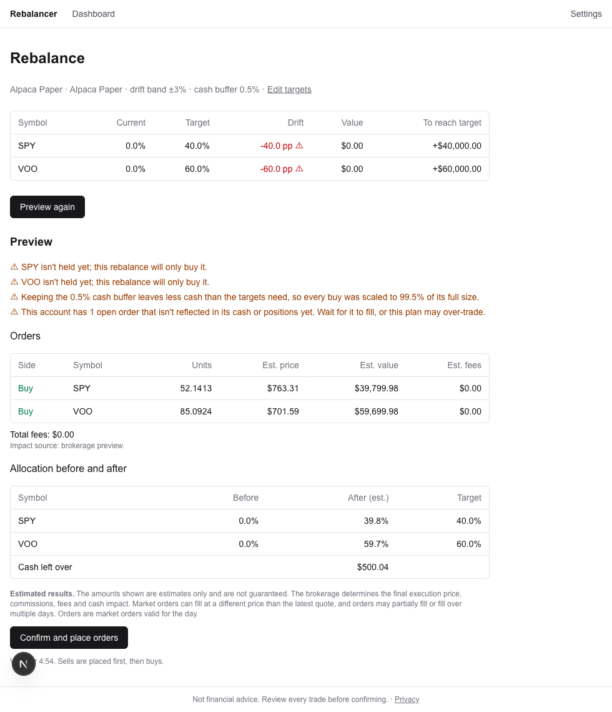

# Rebalancer

Keep your portfolio on target across your brokerages. Sign in with SnapTrade (OAuth + OpenID Connect), see your holdings and your true exposure (including what your ETFs hold), set a target allocation per account, and rebalance with a reviewed, confirmed set of orders: sells first, then buys, with live order tracking.



**Live:** _TODO: add the Vercel URL after deploying_ · **Decisions and trade-offs:** [DECISIONS.md](DECISIONS.md)

## Run locally

Requires Node 20+ and a Postgres database.

```bash
npm install
cp .env.example .env.local        # then fill it in (see below)
createdb rebalancer_dev && npm run db:migrate
npm run dev                       # binds http://127.0.0.1:3000
```

Open **http://127.0.0.1:3000**. Use `127.0.0.1`, not `localhost`: the OAuth redirect URI must match exactly, and cookies are per host. (Starting sign-in on `localhost` redirects you to the right address first.)

You need a SnapTrade **OAuth app** (Dashboard → OAuth Apps, _not_ the API key pair) with the redirect URI `http://127.0.0.1:3000/api/auth/callback` registered, and a SnapTrade Personal workspace with at least one brokerage connected (the SnapTrade Sandbox or a paper account works). Test OAuth apps are limited to 5 users.

| Command | What it does |
|---|---|
| `npm test` | Unit tests, plus the execution integration tests (these use a local Postgres at `rebalancer_dev` and are skipped if it isn't reachable; SnapTrade is always mocked) |
| `npm run build` | Production build |
| `npm run lint` / `npm run typecheck` | ESLint / TypeScript |
| `npm run db:generate` / `db:migrate` | Create / apply Drizzle migrations |

## Environment variables

Validated with zod at server start; a missing or malformed value stops the server and names the key (never the value).

| Variable | Purpose |
|---|---|
| `SNAPTRADE_OAUTH_CLIENT_ID`, `SNAPTRADE_OAUTH_CLIENT_SECRET` | The OAuth app's credentials. Server only. |
| `SNAPTRADE_ISSUER` | `https://api.snaptrade.com`. Endpoints are discovered from it, never hard-coded. |
| `APP_BASE_URL`, `OAUTH_REDIRECT_PATH` | Together form the redirect URI. Register it exactly, including any trailing slash. |
| `SESSION_PASSWORD` | 32+ random characters; encrypts the session cookie. |
| `TOKEN_ENCRYPTION_KEY` | 32 random bytes, base64 (`openssl rand -base64 32`); AES-256-GCM key for tokens at rest. |
| `DATABASE_URL` | Postgres (Neon pooled connection string in production). |
| `CRON_SECRET` | _Optional._ 16+ characters. Authorizes `/api/cron/advance-runs`, which finishes waiting rebalances (placing buys after sells fill) on serverless hosts. Vercel Cron sends it automatically. The endpoint is disabled without it. |
| `ALPHAVANTAGE_API_KEY` | _Optional._ Live ETF holdings weights for look-through exposure. Without it, a static approximate table is used. |

Deploying to Vercel: set the same variables (with `APP_BASE_URL` = the Vercel URL), run `npm run db:migrate` once against the production database, and register `https://<app>.vercel.app/api/auth/callback` as a redirect URI in the SnapTrade Dashboard.

## How it works

```
Browser ──► Next.js (App Router, route handlers, Node runtime) ──► SnapTrade API (Bearer token only)
                         │
                         └──► Postgres: users, encrypted tokens, targets, runs, orders, ETF cache
```

- **Auth** ([lib/oauth](lib/oauth), [app/api/auth](app/api/auth)): authorization code + PKCE (S256) with fresh `state` and `nonce`; the `id_token` is verified (RS256 via cached JWKS, `iss`, `aud`, `exp`, `iat`, `nonce`) and then discarded. Access and refresh tokens are AES-256-GCM encrypted. Refresh tokens rotate, so refreshing happens inside a transaction holding a row lock; a 401 triggers exactly one refresh and one retry, and then the "please sign in again" screen.
- **Portfolio** ([lib/snaptrade](lib/snaptrade), [lib/engine/portfolio.ts](lib/engine/portfolio.ts), [lib/engine/exposure.ts](lib/engine/exposure.ts)): positions and cash are normalized into `AccountSnapshot`s. True exposure to a symbol is its direct value plus, for every ETF held, the ETF's value times that symbol's weight in the ETF. ETFs without weight data are counted as themselves and flagged.
- **Rebalancing** ([lib/engine](lib/engine)), per account, because cash can't move between brokerages through the API:
  1. Holdings without a target are never touched. The base is cash plus the value of the targeted holdings.
  2. If no holding is further than the drift band from its target: "Within band, no trades needed." If any is, **every** targeted holding is rebalanced to target, so the portfolio isn't left half-fixed.
  3. Sells for overweight holdings; buys for underweight ones, funded by cash plus sell proceeds minus the cash buffer. If funds are short, all buys scale down by the same factor. Units always round down, so cash is never overspent; trades below the minimum size are dropped.
- **Preview and execution** ([lib/rebalance](lib/rebalance)): the preview re-fetches everything fresh, asks the brokerage for each order's impact, and saves a run that expires after 5 minutes. Confirming atomically claims the run (a double click can't submit twice) and places the sells. **The rest happens on its own**: once the sells fill, the buys are recomputed from the account's actual cash (never more than you confirmed) and placed, whether or not you are on the page. A driver keeps going after the response; a once-a-minute worker (long-lived servers) or the cron endpoint (serverless) handles long waits such as a closed market. Read-only accounts get a manual trade list instead.

## Project structure

```
app/                     Routes only: thin pages (metadata + header + <Suspense> loader) and API route handlers
components/
  ui/                    Design-system primitives: Card, Panel, Button, Badge, Notice, Table, Field, ...
  layout/ auth/          Header, nav, theme toggle, footer; sign-in and re-auth screens
  dashboard/ targets/    One folder per feature; one component per file;
  rebalance/ run/        client state in `use-*.ts` hooks, rendering in presentational components
  landing/ settings/ privacy/
lib/
  engine/                Pure rebalancing logic (drift, sells, buys, warnings, look-through exposure), no I/O
  rebalance/             Preview, execution state machine, order submit/refresh, run persistence
  snaptrade/ oauth/      Bearer-only API client with 401 retry; PKCE login, token storage and rotation
  db/ etf/ ...           Drizzle schema, ETF holdings cache, env validation, crypto, session
data/                    Static fallback ETF weights
```

Design tokens (light and dark) live in [app/globals.css](app/globals.css); components use semantic names (`bg-surface`, `text-muted`, `border-line`), never raw colours.

## Targets: direct holdings or total exposure

Each account has a setting for what a target percentage means. **Direct holdings** (the default): the share of the account held in that symbol itself. **Total exposure**: for a stock, its total share of the account including what your ETFs already hold of it. With Apple at 20% total and 30% each in SPY and VOO, about 4.5% of Apple already comes from the ETFs, so only about 15.5% is held directly, and the preview says so before anything is confirmed. ETF weights are approximate (top holdings, cached daily), so the adjustment is too.

## Order history

`/history` lists every rebalance that was placed or queued, newest first, with the status of each order. Orders waiting on the market show as *queued* and the run flips to *completed* by itself once they fill. Only one rebalance can run per account at a time; trying to start a second is refused with a link to the first.

## Known limitations

- **Crypto trades are listed, not placed.** Only equity/ETF orders are executed; crypto needs a separate pair/quote workflow.
- **Single-currency USD accounts only.** Mixed- or non-USD accounts are excluded, with a warning.
- **Look-through exposure covers ETFs held directly and uses top-holdings weights** from Alpha Vantage (24-hour cache, 25 requests a day on the free tier), so it understates the true exposure of broad funds. Without a key it falls back to approximate demo weights, labelled as such.
- **SnapTrade limits Personal users to ~10 requests a minute per account.** Rapid refreshing or previewing can hit it. The app shows a wait-a-minute message and polls conservatively (every 6s).
- **Market orders only, valid for the day.** Orders placed while the market is closed stay open until it opens; the run shows as "partly done" and updates as they fill.
- **Open orders aren't in positions or cash.** The preview warns when there are any.
- **Binance SPOT reports three different totals** (accounts list, account details, and the sum of positions) that don't reconcile. The app builds everything from positions plus cash and warns when SnapTrade's own total differs by more than 5%.
- **Trading through SnapTrade OAuth is in beta.** Errors are shown in plain language and never crash a page.
- Not financial advice.

## What I'd build next

- **Webhooks** for connection events (the `webhook` scope) to refresh data and flag broken connections.
- **Scheduled drift alerts** (email or push) instead of checking manually.
- **A real ETF holdings data provider** for complete, dated weights.
- **Multi-currency accounts** with FX handling, and crypto order placement.
- Limit orders and a per-trade cost/tax view.
